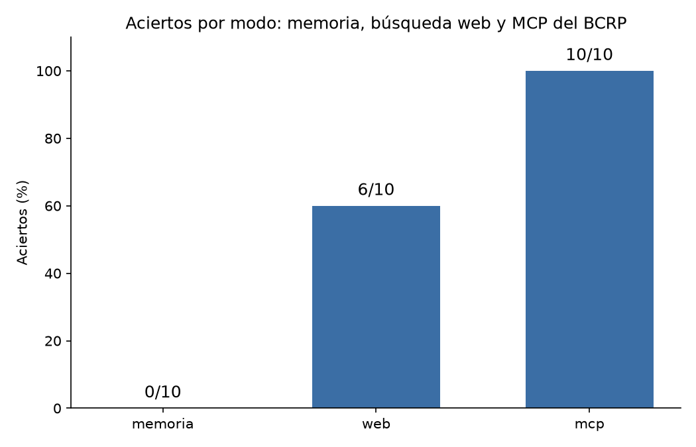

# ¿Inventa cifras Claude? Memoria, búsqueda web y MCP del BCRP

Hicimos las 10 preguntas de `preguntas.csv` a Claude Haiku (`claude -p`) en tres modos: solo memoria, con búsqueda web y con nuestro servidor MCP del BCRP. Cada respuesta se comparó con la cifra oficial y su tolerancia. Todas las cifras de este informe salen de `resultados.csv` o se comprobaron a mano en la web del BCRP.

## Resultados

| Modo | Aciertos | Errores | "No sé" | Segundos promedio |
|---|---|---|---|---|
| memoria | 0 | 0 | 10 | 7,0 |
| web | 6 | 0 | 4 | 25,2 |
| mcp | **10** | 0 | 0 | 16,2 |

Ningún modo dio una cifra equivocada: cuando no sabía la respuesta, Claude puso `null` en vez de estimar.

## Qué acertó y qué falló cada modo, y por qué

### Memoria: 0 aciertos y 10 "no sé"

Respondió "no sé" en las 10 preguntas. En la columna `fuente` explica que no tiene acceso a internet y que sus conocimientos terminan en junio de 2026, así que no conoce los datos de 2025-2026. Siempre indicó dónde buscar la cifra (INEI o BCRP). **No inventó ninguna cifra.**

### Web: 6 aciertos y 4 "no sé"

Acertó `ipc_set26`, `ipc_dic25`, `ipc_mar25`, `tc_15oct26`, `rin_ago26` y `pbi_2025`. Solo dos de esos datos salieron directamente del BCRP: el tipo de cambio (API de la serie PD04638PD) y las reservas (página de la serie PN00027MM). Los otros cuatro salieron de notas de prensa o de informes del INEI citados por terceros (Finanzas Digital, La Cámara, BBVA Research, El Comercio, Forbes Perú, Gestión, RPP).

Respondió "no sé" en 4 preguntas. Según la columna `fuente`:

| Pregunta | Por qué no respondió |
|---|---|
| `cobre_ago26` | La serie anual PM40090BA solo llega a 2025, y en la página mensual que abrió (PM05004MA) no aparecía agosto de 2026. Solo encontró datos de Cochilco citados por Reporte Minero: un promedio parcial al 24 de agosto que no es del BCRP ni cubre el mes completo. |
| `ipc_prom25` | Solo encontró el dato de cierre de año (diciembre contra diciembre), 1,51%. Gestión llamaba a esa misma cifra "promedio de 12 meses", lo que contradice a las otras fuentes. Decidió no promediar las 12 tasas mensuales por su cuenta porque sería una estimación. |
| `referencia_set26` | Un resultado de búsqueda de Perú Retail decía 4,25%, pero la página no abrió (HTTP 403). Tampoco pudo entrar a bcrp.gob.pe. Además, otros artículos daban cifras de otras fechas o contradictorias, así que no pudo confirmar el dato. |
| `subyacente_set26` | Las notas que encontró daban la inflación total (4,55% a 12 meses) y la subyacente **mensual**, pero no la subyacente a 12 meses. No llegó a la serie del BCRP. |

Además fue el modo más lento: **25,2 s** en promedio, frente a 16,2 s del MCP.

### MCP: 10 aciertos

Acertó las 10. Cada respuesta indica el código de la serie del BCRP, el periodo y la URL de la API de donde sale el dato (por ejemplo `PN01273PM`, `PD04722MM`, `PN38784BM`, `PM04923AA`). Por eso cada cifra se puede verificar.

### Mis dos preguntas

- **`ipc_prom25` (promedio 2025 de la inflación a 12 meses).** La web falló porque nadie publica un "promedio 2025": la prensa solo da el cierre de diciembre. El MCP respondió **1,5018** con la serie PN01273PM, "promedio de los 12 meses de 2025 (completo)". Ese cálculo lo hace mi herramienta `promedio_anual`.
- **`subyacente_set26` (inflación subyacente a 12 meses, setiembre de 2026).** La web solo encontró la inflación total y la subyacente mensual. El MCP encontró la serie **PN01279PM** con `buscar_series` y respondió **2,85** (valor exacto 2,848234%).

## Mi herramienta: promedio_anual

`promedio_anual(codigo, desde, hasta)` toma una serie **mensual** del BCRP y devuelve, para cada año:

- `promedio`: el promedio de los meses del año;
- `cierre`: el último mes con dato;
- `meses`: cuántos meses tienen dato;
- `completo`: `True` si son 12 meses;
- `cambio_promedio` y `variacion_pct_promedio`: la comparación con el año anterior. En el primer año del rango quedan en `null`, porque no hay año anterior.

**Por qué puntos porcentuales para tasas y variación % para montos.** La inflación o una tasa de interés ya están expresadas en %. Si se calcula la variación % de una tasa, cambios chicos se ven enormes: pasar de 2% a 4% sería "+100%", aunque la inflación solo subió 2 puntos. Por eso, para tasas se usa `cambio_promedio`, la diferencia en puntos porcentuales. Para montos, como reservas o exportaciones, la variación % sí tiene sentido, y se usa `variacion_pct_promedio`.

**Por qué marca los años incompletos (`completo=False`).** El año en curso solo tiene algunos meses, y su promedio no se puede comparar con el de un año de 12 meses: le faltan los meses que todavía no ocurrieron. Con esta marca, el modelo puede avisar en vez de comparar mal.

**Prueba en Claude Code.** Ante la pregunta "¿cuál fue la inflación promedio a 12 meses de Lima en cada año desde 2020?", Claude eligió `promedio_anual` por su cuenta y avisó que 2026 solo tiene 9 meses, así que no es comparable con los años completos.

## Cifras comprobadas a mano en la web del BCRP

- **Inflación subyacente a 12 meses, setiembre 2026: 2.85 %** (PN01279PM). Coincide con el MCP.
  https://estadisticas.bcrp.gob.pe/estadisticas/series/mensuales/resultados/PN01279PM/html/2025-1/2026-9/
- **Promedio 2025 de la inflación a 12 meses: 1.5018 %** (promedio en Excel de los 12 meses de PN01273PM). `promedio_anual` dio 1.50 %. Coincide.
  https://estadisticas.bcrp.gob.pe/estadisticas/series/mensuales/resultados/PN01273PM/html/2025-1/2025-12/

## Hallazgos al conectar y evaluar

- El recurso plantilla `bcrp://serie/{codigo}` funcionaba en Python, pero en Claude Code el `@` no adjuntaba su contenido. Agregué recursos fijos para 4 series y funcionó.
- El prompt `/mcp__bcrp__informe` devolvió 5 viñetas con código, periodo y URL.
- En Windows, `evaluar.py` falló por un error de codificación: leía la salida en cp1252 en vez de UTF-8. Lo corrí con `PYTHONUTF8=1` y después agregué `encoding="utf-8"` en `subprocess.run`.

## Experimento extra

Comparé los tres modos con `uv run evaluar.py --modos memoria web mcp`.

- **Web frente a memoria:** la web pasó de 0 a 6 aciertos, pero tardó más (25,2 s frente a 7,0 s). Sin herramientas, el modelo no tiene datos de 2025-2026. Con la web consigue los que salen en la prensa.
- **Web frente a MCP:** el MCP acertó 4 preguntas más (10 frente a 6) y fue más rápido (16,2 s frente a 25,2 s). La web falla justo donde el dato no aparece en una nota de prensa: un promedio que hay que calcular (`ipc_prom25`), una serie específica (`subyacente_set26`, `cobre_ago26`) o una página del BCRP que no carga (`referencia_set26`). Además, 4 de sus 6 aciertos vienen de prensa y no de la fuente oficial.

## Conclusión

Vale la pena construir un MCP cuando se consultan seguido datos de una misma fuente oficial, sobre todo si hay que calcular algo (promedios, comparaciones entre años) o encontrar una serie específica. En esta prueba fue más preciso, más rápido y siempre citó su fuente. La búsqueda web alcanza para datos sueltos que salen en la prensa, como el cierre de la inflación o el PBI del año. Pero no siempre cita la fuente oficial y se queda sin respuesta cuando el dato no está publicado tal cual. En ningún modo Claude inventó cifras: sin datos, respondió "no sé".
